# PulseStream: cycling climb analytics on Microsoft Fabric

An end-to-end analytics project on Microsoft Fabric: a synthetic telemetry generator, a Bronze, Silver and Gold lakehouse pipeline with data quality checks, a Direct Lake semantic model with row-level security, and a five-page Power BI report. The theme is the Alpe d'Huez climb (13.8 km, 21 hairpins), but **all data is synthetic**: the riders and teams are fictional, and the route is a stylised layout, not a GPS track.

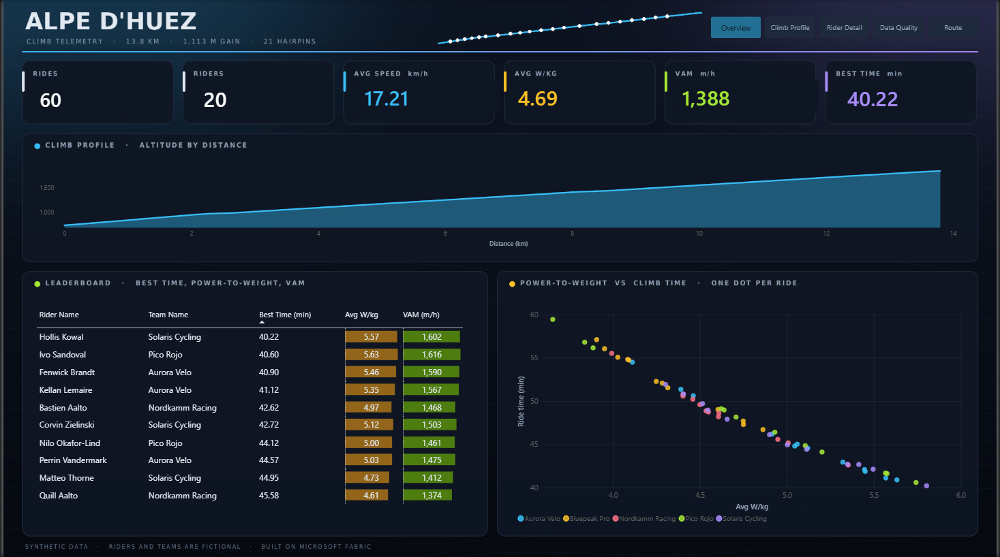

## What this project demonstrates

| Area | What is in the project |
|---|---|
| Data engineering | Fabric notebooks, Delta tables, a medallion architecture, window functions, a quarantine table for rejected rows |
| Data quality | Eight validation rules, deliberately injected bad rows, a rule scorecard that reports every failure instead of dropping rows silently |
| Semantic modelling | Star schema, Direct Lake, 25 measures in display folders, a calculation group, a field parameter, dynamic format strings |
| Security and governance | Row-level security with one role per team, endorsement as Promoted |
| Lifecycle management | GitHub integration through Git integration in Fabric, a deployment pipeline from Development to Test, lineage view |
| Performance | Visuals checked with Performance Analyzer and DAX query view |
| Report design | Dark "cockpit" theme, custom page backgrounds, tooltip page, consistent number formats |

## Architecture

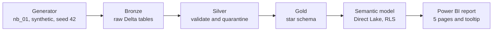

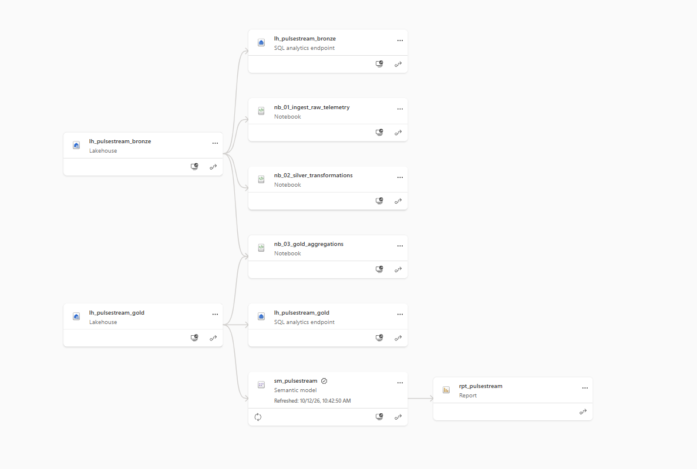

| Layer | Item | Content |
|---|---|---|
| Source | `nb_01_ingest_raw_telemetry` | Synthetic generator (seed 42) |
| Bronze | `lh_pulsestream_bronze` | `raw_telemetry_bronze` (173,211 rows), `dim_ride_bronze` (60 rides), `dim_rider_bronze` (20 riders), `dim_team_bronze` (5 teams), `dim_turn_bronze` (21 bends) |
| Silver | `nb_02_silver_transformations` | `fct_telemetry_silver` (172,865 clean rows), `quarantine_telemetry_silver` (346 rejected rows), `silver_dq_summary`. The Silver tables are stored in the Bronze lakehouse |
| Gold | `lh_pulsestream_gold`, `nb_03_gold_aggregations` | `dim_rider`, `dim_turn`, `dim_date`, `dim_route_profile`, `dim_route_trail`, `fact_ride`, `fact_turn_split`, `fact_telemetry`, `dq_summary` |
| Model | `sm_pulsestream` | Direct Lake semantic model |
| Report | `rpt_pulsestream` | Five pages plus the `Bend Tooltip` page |

## The synthetic data

The generator builds each ride from a simple physical model rather than random noise:

- **Speed** is derived from power and gradient, using gravity, rolling resistance and air drag, solved with Newton's method.
- **Heart rate** follows power with a delay and drifts slightly over the ride.
- **Fatigue** lowers power gradually, and the riders sprint over the last 1.5 km.
- **Route:** 13.8 km from 737 m to 1,850 m (1,113 m of climbing, 8.1% average gradient). The altitudes of four bends are pinned to published values and the bend positions are approximate. Two flat stretches (around bends 16 and 7) are built in on purpose.
- **Bad rows:** 0.2% of the rows are broken on purpose (missing heart rate, impossible power, GPS speed spikes) and flagged with `is_injected_issue`, so the validation step can be checked against a known answer.

The generator lives in the notebook `fabric/nb_01_ingest_raw_telemetry.Notebook/`.

## Data quality

The Silver notebook applies these rules and writes every rejected row to a quarantine table together with the rule it failed.

| Field | Rule |
|---|---|
| Heart rate | present, 30 to 215 bpm |
| Power | 0 to 1,500 W |
| Speed | 0 to 45 km/h |
| Cadence | 0 to 150 rpm |
| Gradient | -5 to 20 % |
| Altitude | 700 to 1,900 m |
| Duplicates | reported only, one row per ride and second |

Result: 173,211 rows checked, 346 rejected (0.20%), 172,865 clean. All 346 injected rows were caught: 115 missing heart rates, 115 impossible power values and 116 speed spikes. The Gold notebook also runs eight orphan-key checks, and all of them return zero.

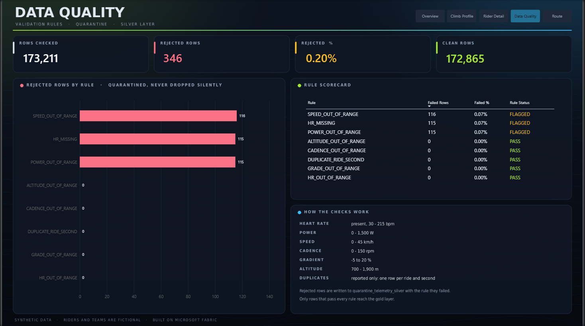

## Semantic model

`sm_pulsestream` is a Direct Lake model on the Gold lakehouse, with hidden keys, six relationships and 25 measures grouped in display folders (for example `Segment Pace (s/km)`, `Power Fade %`, `VAM`, `Rejected %`).

- **Calculation group `Comparison`** with the items Actual, Delta vs all riders and Percentage vs all riders. The delta items use `SELECTEDMEASURE()` against `CALCULATE(SELECTEDMEASURE(), ALL(dim_rider))`, and they carry dynamic format strings.
- **Field parameter `Section Metric`** lets one chart on the Climb Profile page switch between segment pace, speed, heart rate and time. It works in Direct Lake mode.
- **Dynamic format string** on `Rejected %`, which shows two decimals for small values.
- Implicit measures are discouraged, so every number in the report comes from an explicit measure.

## Report

| Page | Content |
|---|---|
| Overview | KPI cards, altitude profile, leaderboard, power-to-weight against climb time |
| Climb Profile | Speed and heart rate by hairpin, gradient by hairpin, a metric selector for section pace |
| Rider Detail | Power, heart rate and speed over time for one ride, power fade, a comparison slicer |
| Data Quality | Validation scorecard and rejected rows by rule |
| Route | Stylised switchback route coloured by gradient, bend-by-bend fact sheet |
| Bend Tooltip | Speed, heart rate and gradient for the hovered bend |

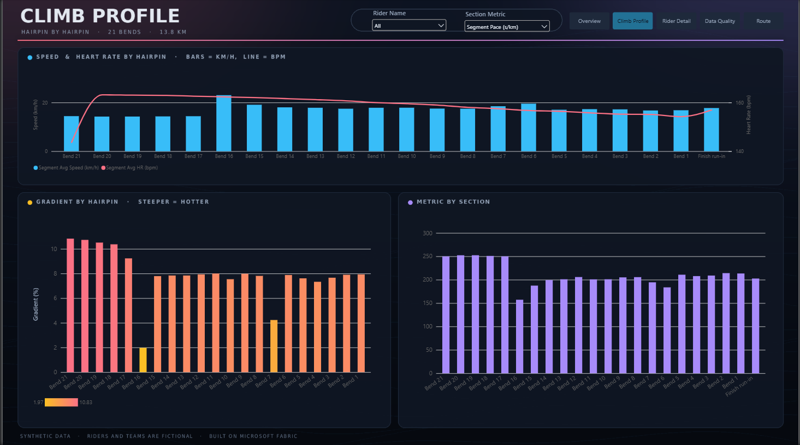
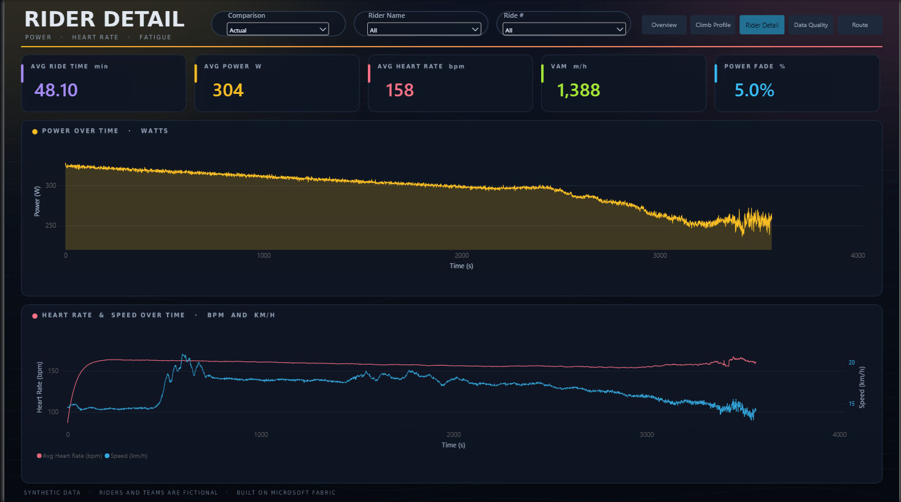
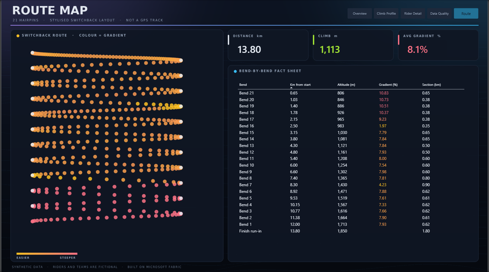
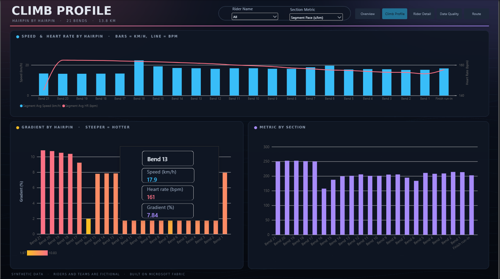

### What the data shows

The numbers are synthetic, but they behave like a real climb: power-to-weight and ride time form a clear inverse relationship, power fades by about 5% across a ride, and the pace per kilometre is about 250 s/km on the steep first kilometres, about 200 s/km on the middle sections and about 157 s/km on the flat stretch near bend 16.

## Security and governance

- **Row-level security:** one role per team (Aurora Velo, Bluepeak Pro, Nordkamm Racing, Pico Rojo, Solaris Cycling). Each role filters `dim_rider` by team name, and the filter flows to all fact tables through the relationships. Route, turn, date and data quality tables are shared reference data.
- **Verification:** the filter logic was checked with DAX queries (4 riders and 12 rides per team). An interactive role test was not possible, because "Test as role" does not work with single sign-on on a Direct Lake model.
- **Endorsement:** the semantic model is endorsed as Promoted.
- **Sensitivity labels** are disabled in the tenant used for this project, so no label is applied.

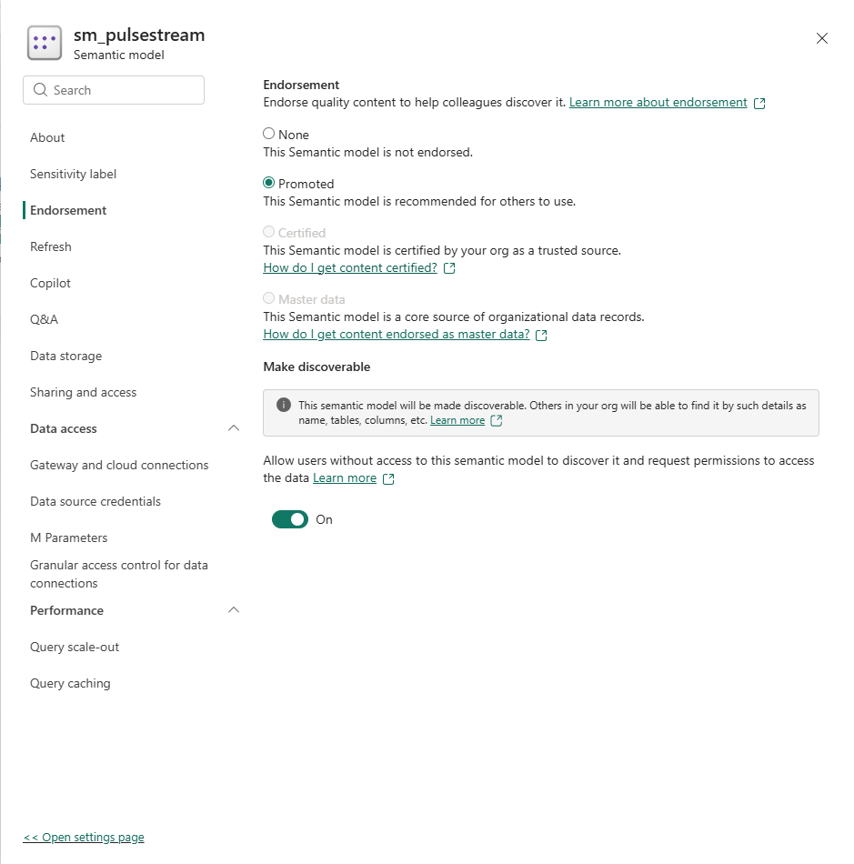

## Lifecycle management

While I developed the project, the Fabric workspace was connected to a GitHub repository through Git integration (branch `main`, folder `fabric`), so notebooks, lakehouse definitions, the semantic model and the report were versioned as code. The `fabric/` folder in this repository is the synced result; I squashed the commit history into a single commit before publishing. A deployment pipeline promotes the items from Development to Test. The Test stage contains item definitions only: lakehouse items are deployed as definitions, so the data is produced by running the notebooks. After a deployment only the semantic model is still marked as different from the source; the differences I inspected were metadata in the calculation group (partition name and item order).

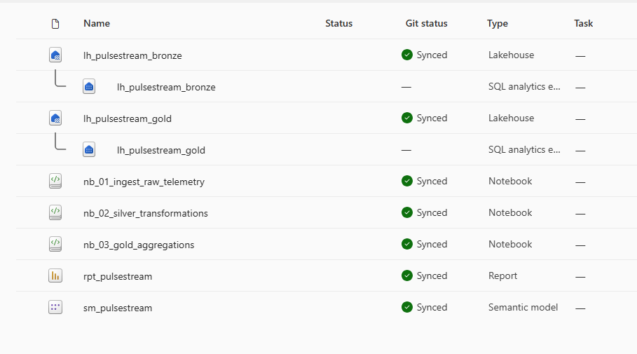
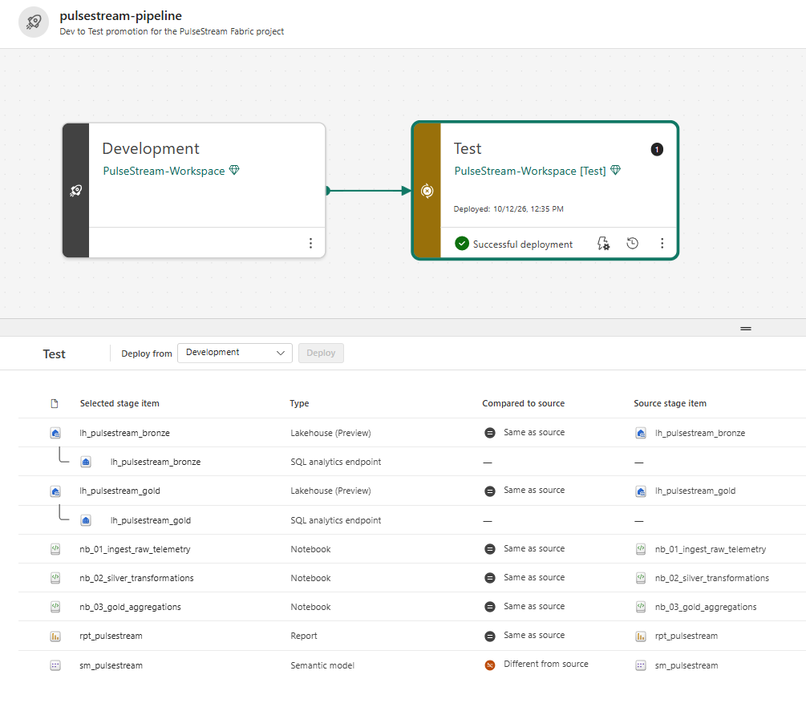

## Performance

I recorded the report with Performance Analyzer and expanded a sample of the slowest visuals. None of the expanded visuals fell back to DirectQuery, so the model stays in Direct Lake mode. The DAX queries themselves are fast (about 50 to 200 ms per visual in the visuals I expanded); most of the time shown for a visual is rendering and waiting for other visuals to finish. Total times vary between runs: most visuals take about 0.4 to 1.4 seconds, the two time-series charts on the Rider Detail page, which average about 3,600 seconds of telemetry per series, take about 1 to 2 seconds, and selecting the delta comparison adds about 0.4 seconds, because the calculation group evaluates each measure twice. The measurements were taken without a security role applied, and the first load of a page is slower than later loads, because Direct Lake loads columns into memory on first use.

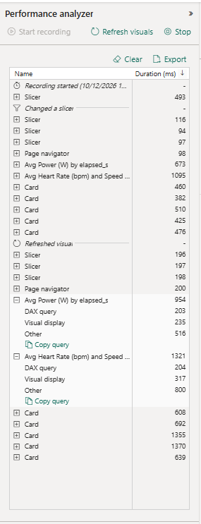

## Validation

The report figures were cross-checked with DAX queries in the semantic model: 173,211 rows checked, 346 rejected (0.0020 as a ratio), 172,865 clean, and 4 riders and 12 rides for each of the five teams. The best times per team match the leaderboard.

## Challenges and what I learned

- **A relationship pointed at the wrong column.** `dim_rider[rider_id]` was joined to `fact_ride[ride_id]`. Checking rides per team (it must be 12) exposed it, and the fix was verified the same way.
- **A notebook silently ran old code** because the new version was not pasted. I now check for the expected output lines (row counts of the new tables) after every run.
- **Columns with the same name in two tables** (`x_pos`, `y_pos`): a visual picked the one from the unrelated table and drew a single dot. Checking the source table of every field fixed it.
- **Scatter charts need an explicit aggregation** on X and Y when a field is in Values. Columns set to "Don't summarize" otherwise fail with "Can't display this visual".
- **A calculation group written through TMDL** (`createOrReplace`) left the table unprocessed, so its slicer was empty until the model was refreshed.
- **Formatting on a visual can override a measure's format string**, which showed up as a rejection rate card that did not match the dynamic format string.
- **Raw column names and default sort orders** made tables read in the wrong order. Every table now has renamed headers and an explicit sort that matches its title.
- **Getting a Fabric capacity took some trial and error.** The Fabric trial was not available in my tenant, so I created an F2 capacity in Azure. Some regions had no F2 capacity available when I tried, and France Central worked. The capacity has to be resumed before a workspace works again.
- **Git integration for GitHub is off by default** in the tenant and had to be enabled in the admin settings.
- **The deployment pipeline** marked the semantic model as different after the first deployment. The comparison showed only metadata differences in the calculation group (partition name and item order).

## Limitations

- All data is synthetic, and the route is stylised, not a GPS track.
- The Test stage holds item definitions only, not data.
- Row-level security was verified with DAX, not with an interactive role test.
- The report was designed for the Fabric workspace it was built in. Rebuilding it elsewhere needs a Fabric capacity and the steps below.

## Environment

- **Capacity:** a Microsoft Fabric F2 capacity (the smallest paid SKU) in the France Central region. I created it in Azure, because the Fabric trial was not available in the tenant I used, and I paused it between work sessions.
- **Workspace:** one Fabric workspace for development and a second one for the Test stage of the deployment pipeline, both on the same capacity.

## Reproducing the project

1. Create a Fabric workspace on a Fabric capacity and connect it to this repository (Git integration, branch `main`, folder `fabric`), or import the notebooks manually.
2. Attach the Bronze and Gold lakehouses to the notebooks.
3. Run `nb_01_ingest_raw_telemetry`, then `nb_02_silver_transformations`, then `nb_03_gold_aggregations`.
4. Refresh the semantic model `sm_pulsestream` and open the report `rpt_pulsestream`.

## Repository layout

```text
.
├── README.md
├── LICENSE
├── .gitignore
├── fabric/          Fabric items synced through Git integration
└── screenshots/     Images used in this README
```

## License

MIT, see [LICENSE](LICENSE).
